# NetCore TUI — UML Models

| Field          | Value                              |
| -------------- | ---------------------------------- |
| Owner          | ARCHITECT                          |
| Status         | Approved baseline v1.0             |
| Notation       | Mermaid (renders on GitHub / IDEs) |
| Last updated   | 2026-11-27                         |

Diagrams are the contract for class names, relationships and public
method signatures. Implementations MAY add private helpers but MUST NOT
rename or remove public members shown here without an accepted decision.

---

## 1. Package Diagram

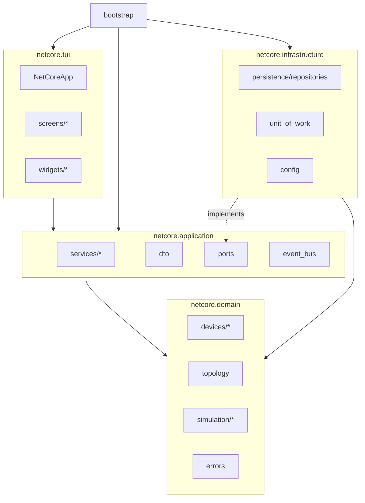

## 2. Core Domain Class Diagram

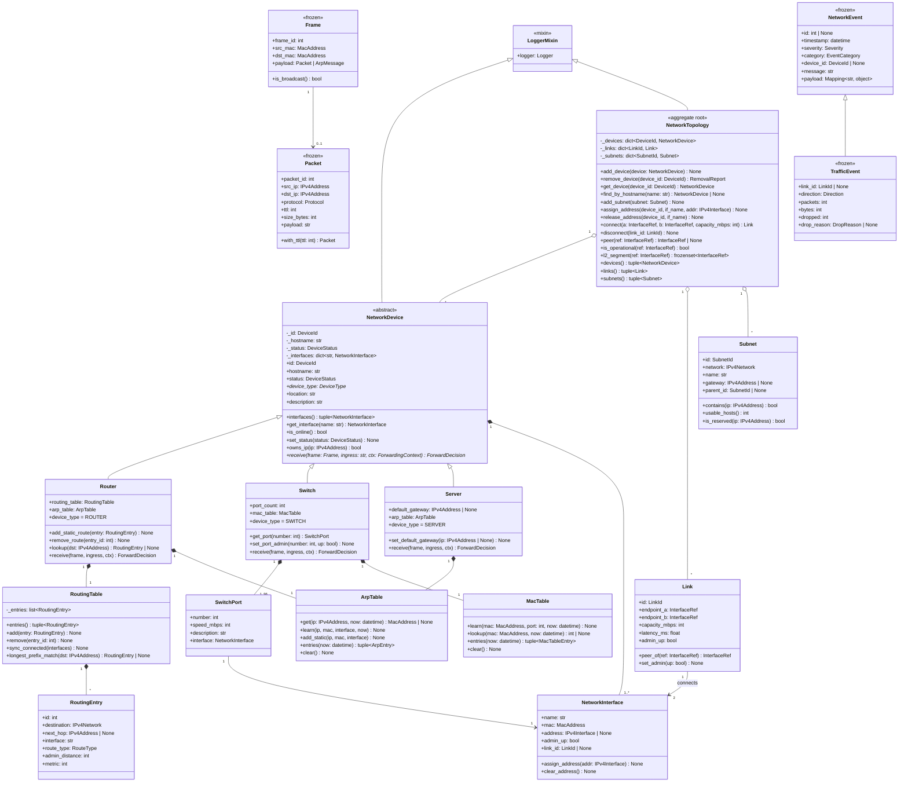

## 3. Simulation Class Diagram

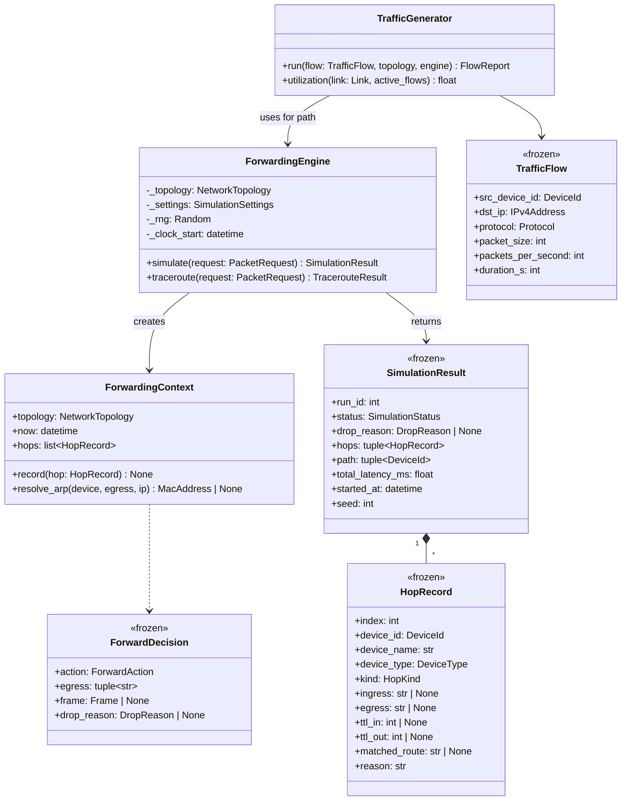

## 4. Enumerations

```mermaid
classDiagram
    class DeviceType { <<enum>> ROUTER SWITCH SERVER }
    class DeviceStatus { <<enum>> ONLINE OFFLINE MAINTENANCE }
    class Protocol { <<enum>> ICMP TCP UDP }
    class RouteType { <<enum>> CONNECTED STATIC DEFAULT }
    class HopKind { <<enum>> SEND ARP SWITCH ROUTE DELIVER DROP FLOOD }
    class ForwardAction { <<enum>> FORWARD DELIVER DROP FLOOD }
    class SimulationStatus { <<enum>> DELIVERED DROPPED }
    class DropReason { <<enum>> NO_ROUTE TTL_EXPIRED DEVICE_OFFLINE LINK_DOWN INTERFACE_DOWN PORT_DOWN ARP_FAILED NOT_FOR_ME HOP_LIMIT NO_INTERFACE FILTERED CONGESTION }
    class Severity { <<enum>> DEBUG INFO WARNING ERROR CRITICAL }
    class EventCategory { <<enum>> CONFIG STATE FORWARD DROP DELIVERY ARP TRAFFIC SYSTEM }
```

## 5. Domain Error Hierarchy

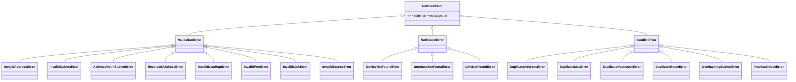

## 6. Application Layer Class Diagram

```mermaid
classDiagram
    class UnitOfWork {
        <<Protocol>>
        +topology: TopologyRepository
        +events: EventRepository
        +simulations: SimulationRepository
        +settings: SettingsRepository
        +__enter__() UnitOfWork
        +__exit__(exc_type, exc, tb) None
        +commit() None
        +rollback() None
    }
    class TopologyRepository {
        <<Protocol>>
        +load() NetworkTopology
        +save(topology: NetworkTopology) None
    }
    class EventRepository {
        <<Protocol>>
        +add(event: NetworkEvent) int
        +query(filter: EventFilter) list~NetworkEvent~
        +prune(keep: int) int
    }
    class EventBus {
        +subscribe(category: EventCategory | None, handler) Unsubscribe
        +publish(event: NetworkEvent) None
    }
    class DeviceService {
        +list_devices(filter) list~DeviceDTO~
        +create_device(req: CreateDeviceRequest) DeviceDTO
        +update_device(req: UpdateDeviceRequest) DeviceDTO
        +delete_device(device_id) RemovalReportDTO
        +set_status(device_id, status) DeviceDTO
    }
    class IpamService {
        +list_subnets() list~SubnetDTO~
        +create_subnet(req) SubnetDTO
        +assign_address(req) InterfaceDTO
        +release_address(device_id, if_name) None
        +next_free_address(subnet_id) str | None
    }
    class RoutingService {
        +routes(router_id) list~RouteDTO~
        +add_static_route(req) RouteDTO
        +remove_route(router_id, route_id) None
        +lookup(router_id, dst_ip) RouteLookupDTO
    }
    class SwitchService {
        +ports(switch_id) list~SwitchPortDTO~
        +set_port_admin(switch_id, port, up) SwitchPortDTO
        +update_port(req) SwitchPortDTO
        +mac_table(switch_id) list~MacEntryDTO~
        +clear_mac_table(switch_id) None
    }
    class TopologyService {
        +snapshot() TopologyDTO
        +connect(req: ConnectRequest) LinkDTO
        +disconnect(link_id) None
        +set_link_admin(link_id, up) LinkDTO
    }
    class SimulationService {
        +send_packet(req: SendPacketRequest) SimulationResultDTO
        +traceroute(req: SendPacketRequest) TracerouteDTO
        +history(limit: int) list~SimulationSummaryDTO~
    }
    class MonitoringService {
        +dashboard_summary() DashboardDTO
        +link_stats() list~LinkStatsDTO~
        +device_stats() list~DeviceStatsDTO~
        +start_flow(req) FlowDTO
        +stop_flow(flow_id) None
        +reset_counters() None
    }
    class EventLogService {
        +query(filter: EventFilterDTO) list~EventDTO~
        +export(filter, fmt, path) ExportResultDTO
    }
    class SettingsService {
        +get() SettingsDTO
        +update(req) SettingsDTO
        +load_sample_lab(name) None
        +reset_lab() None
    }

    UnitOfWork --> TopologyRepository
    UnitOfWork --> EventRepository
    DeviceService --> UnitOfWork
    DeviceService --> EventBus
    IpamService --> UnitOfWork
    RoutingService --> UnitOfWork
    SwitchService --> UnitOfWork
    TopologyService --> UnitOfWork
    SimulationService --> UnitOfWork
    MonitoringService --> EventBus
    EventLogService --> UnitOfWork
    SettingsService --> UnitOfWork
```

## 7. Sequence — Packet Delivery (AT-01)

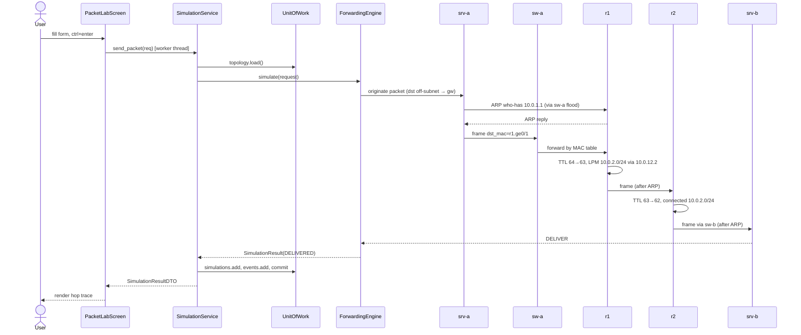

## 8. Sequence — Assign IP with Validation Failure

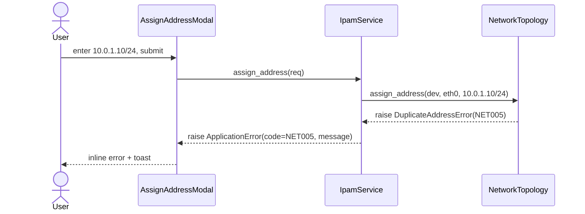

## 9. State Machines

### 9.1 Device Status

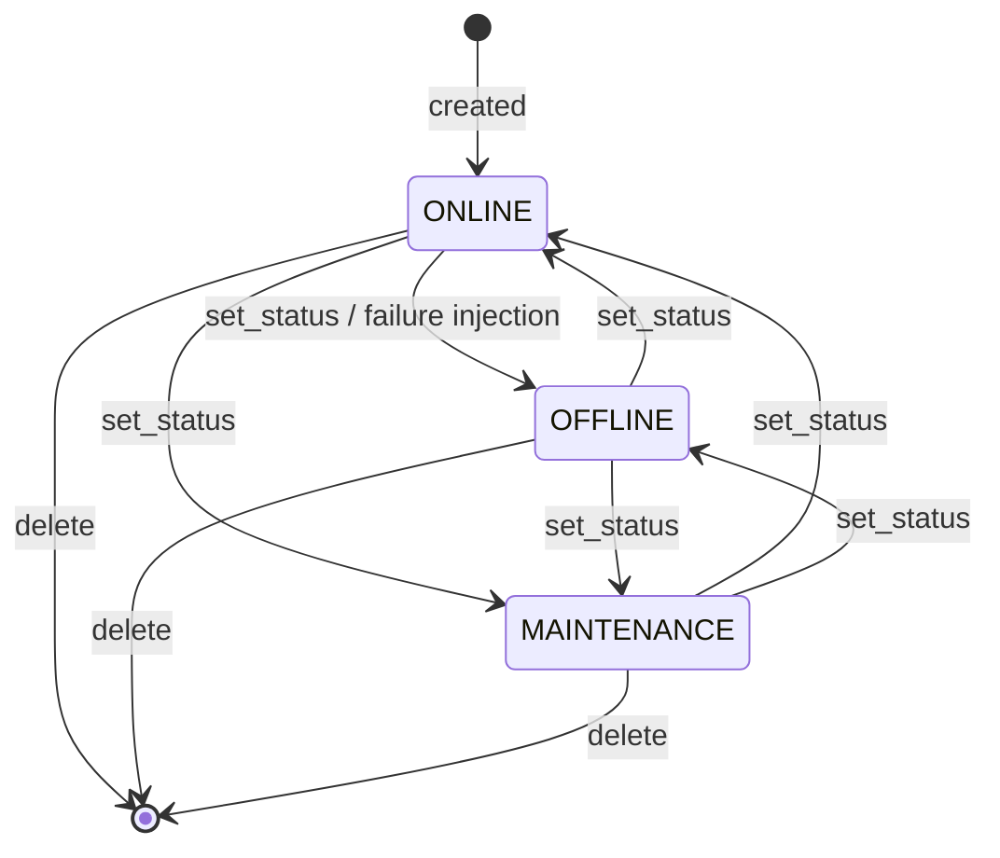

### 9.2 Packet Lifecycle

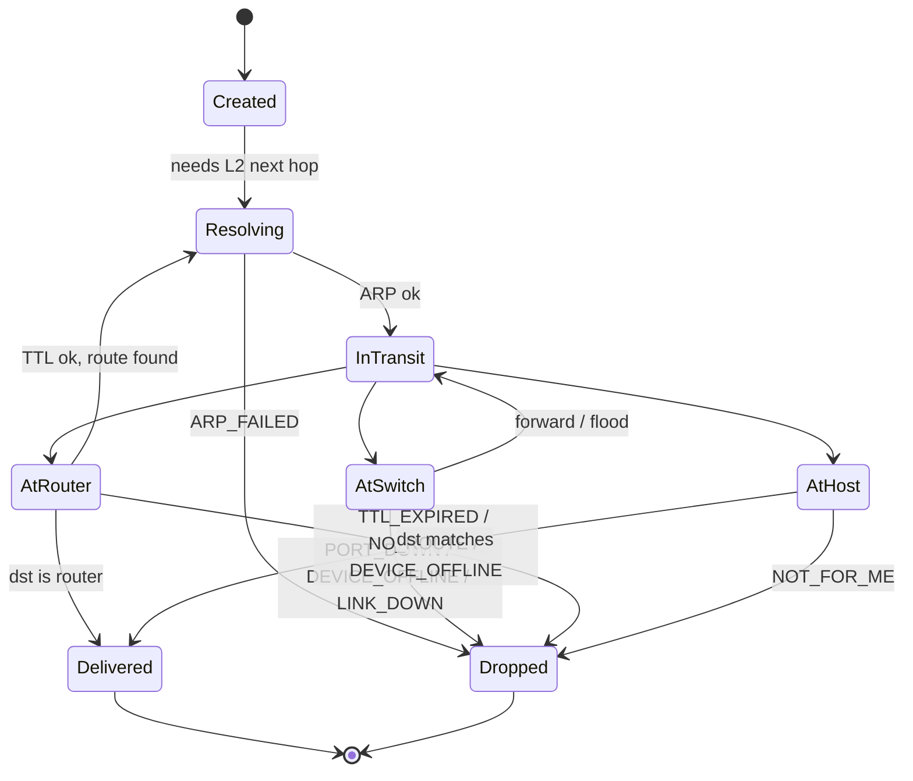

## 10. Entity-Relationship (SQLite schema)

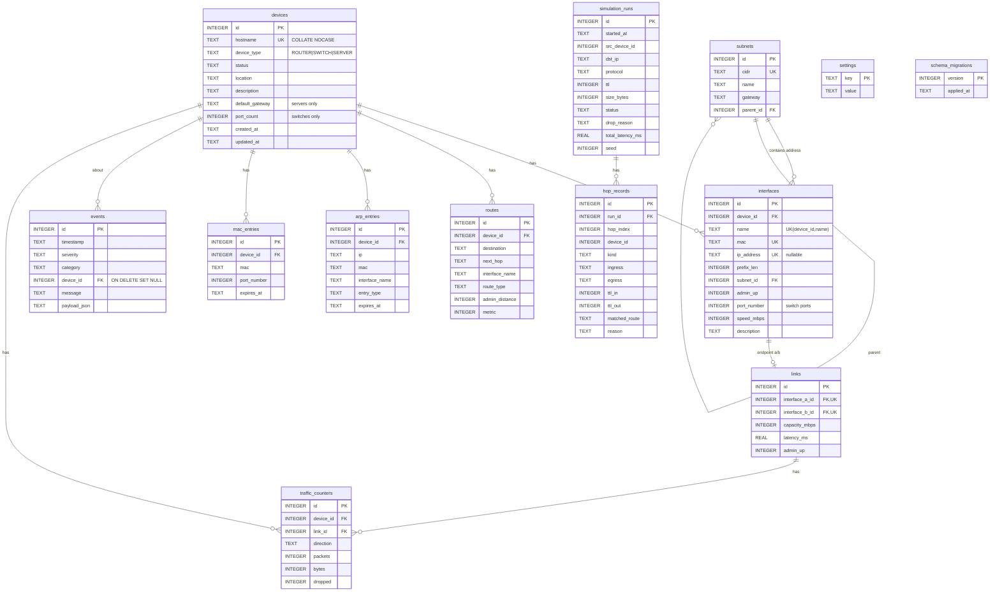

## 11. Use Case Diagram (summary)

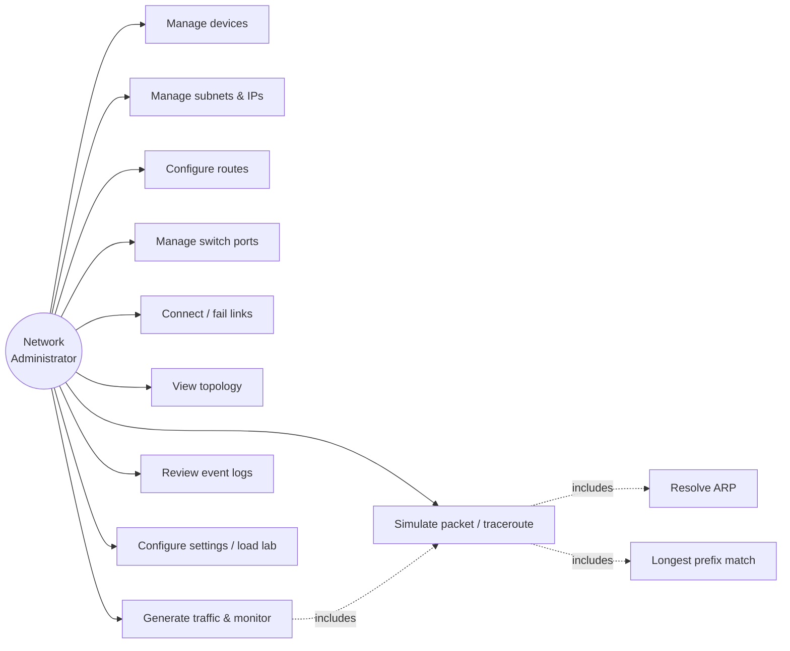
